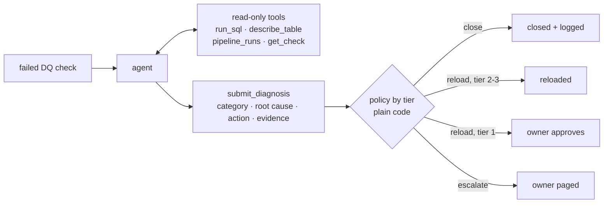

# data-incident-triage-agent

An LLM agent that picks up a failed data-quality check, investigates the warehouse with
read-only tools, and decides whether it's a false alert, late data, a broken model or a
broken vendor feed. A **criticality-tier policy in plain code**, not the model, decides
what then happens on its own and what waits for a person.

It is scored on **48 labelled incidents**, with one hard rule: it must never close a real problem.

> Simulated customer: Harbor & Pine Outfitters is fictional and all data is synthetic,
> generated in `triage/warehouse.py` and `triage/incidents.py`. This is phase 2 of the
> engagement in [sql-to-dbt-migration-agent](https://github.com/artur115/sql-to-dbt-migration-agent):
> the models are migrated, and now someone has to answer the pager.

It is modelled on a production system I co-built. That agent triages about 3,000 data-quality
checks a day, separates false alerts and late data from real breaks, and routes what needs
judgement to the likely owner. The tiering idea comes from the criticality tiers I designed there.

## Results

| | Runbook (no AI) | Agent (Claude) |
|---|---:|---:|
| Diagnosis fully right (category, root cause, action) | **24 / 48** | *not run yet* |
| Real problems closed (must be 0) | 0 | *not run yet* |
| Upstream breaks "fixed" by a reload (must be 0) | 0 | *not run yet* |
| Pages to people | 35 | *not run yet* |
| …of which unneeded (false alert or late data) | 9 | *not run yet* |
| Cost per incident | $0 | *not run yet* |

The agent column is filled in by the first recorded run (`make record`). Until then it stays
empty rather than estimated. Per-incident detail: [`report/scorecard_runbook.md`](report/scorecard_runbook.md).

**What the runbook gets wrong, and why it matters.** A scripted runbook reruns the check and
looks at the last run. That handles late loads and failed runs (21 of 21). It pages a person
for every quiet Sunday and every allowed NULL, and it blames the alerted table when the real
fault is in the vendor feed two hops upstream (0 of 7 timezone incidents fully right).
Those are the cases where an investigation, rather than a rule, earns its cost.

## The incidents

| Template | n | What really happened | Right answer |
|---|---:|---|---|
| late_load | 9 | The nightly run finished after the check fired; the data has landed by now | late_data → close |
| quiet_sunday | 6 | Volume is ~40% of the weekly average, as it is every Sunday | false_alert → close |
| nullable_column | 3 | `customer_id` is NULL for guest checkouts, which the table docs allow | false_alert → close |
| failed_run | 12 | Our model's run failed half-way; its sources are fine | real_break → reload |
| ran_before_parent | 4 | The revenue model ran before `stg_orders` finished, so it is missing a day | real_break → reload |
| vendor_timezone | 7 | The shop API sent local time as UTC, so orders are dated after they were loaded | upstream_break in `raw.orders` → escalate |
| vendor_null_keys | 7 | The payment feed dropped `order_id` on most of a day's payments | upstream_break in `raw.payments` → escalate |

Each incident is built fresh: 60 days of seeded history, then the fault is planted. The agent
only sees the alert, which never contains the label.

## How it works



- **Read-only by construction.** `run_sql` parses the statement and accepts one `SELECT` or
  `DESCRIBE`. Writes are refused and tested (`tests/test_triage.py`).
- **The model proposes, code decides.** The tier and the owner come from `meta.tables`, not
  from the model's answer, so a confident wrong answer on a tier-1 table still waits for a person.
- **Unsure means escalate.** If the agent runs out of turns or never submits, the incident goes to a person.
- **Reproducible evals.** Every model turn is saved under `recordings/`, keyed by a hash of the
  model, effort, prompt, tools and history. CI replays them with no API key, and fails the
  build if the agent ever closes a real problem or reloads over a vendor break.

| Piece | File |
|---|---|
| Warehouse, lineage, runs, checks | `triage/warehouse.py` |
| 48 incidents and their labels | `triage/incidents.py` |
| Tools (strict schemas, read-only) | `triage/tools.py` |
| Agent loop (Messages API, manual tool loop) | `triage/agent.py` |
| Tier policy | `triage/policy.py` |
| Runbook baseline, scoring, scorecards | `triage/evaluate.py` |

Why a hand-written loop instead of a hosted agent: the production system this mirrors runs on
Amazon Bedrock, where you host the loop yourself. Keeping the loop in code also makes every
step recordable for the eval.

## Run it

```bash
pip install -r requirements.txt
make demo            # tests, runbook baseline, agent replay
make record LIMIT=5  # real agent run on 5 incidents to check cost; needs PROOF_ANTHROPIC_API_KEY
make record          # all 48
```

The defaults are `claude-opus-5-5` at high effort (`TRIAGE_MODEL` / `TRIAGE_EFFORT` to change).
Usage and cost go into the scorecard JSON.

## 2-minute walkthrough
1. `triage/incidents.py`: the `vendor_timezone` plant, a vendor bug two hops upstream of the alert.
2. `report/scorecard_runbook.md`: the runbook blames `stg_orders` and pages the wrong team.
3. The agent's scorecard: what it found and the evidence it cited (after `make record`).
4. `triage/policy.py`: why a tier-1 reload still waits for the owner.
5. CI: the build fails if a real problem is ever closed.

---
Artur Kochetkov · [arturkochetkov.dev](https://arturkochetkov.dev) · MIT licence
